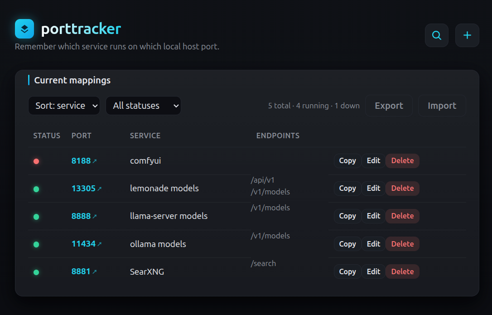

# porttracker

A tiny, minimalistic web app that remembers **which service runs on which port** on your local host — so you never have to dig through `netstat`, config files, or your own scattered notes again.

It's a small CRUD app: add, view, edit, and delete port→service mappings from a single clean page.

## Install & run (Docker)

Requires Docker. Spin up the service on port 3000 effortlessly:

```bash
git clone <repo-url> porttracker
cd porttracker
make run        # clean build + run the container on port 3000
```

Open [http://localhost:3000](http://localhost:3000). Data persists to `~/.porttracker/data.json` (outside the repo), so it survives restarts and re-clones.

Other options: `make run PORT=9000` (different port), `make run DATA_DIR=/custom` (custom data dir), or without Docker just `npm start` (Node 18+). See the [Docker](#docker) and [Customization](#customization) sections below.

## Managing ports with an AI/LLM agent

This repo ships an agent skill (`porttracker-api`, under `skills/`) that teaches an AI harness (e.g. Hermes) the REST API, record shape, and validation rules — so you can drive the app from plain English.

### Add the skill to Hermes

Hermes loads skills from `~/.hermes/skills/`:

```bash
mkdir -p ~/.hermes/skills/software-development
cp -r skills/porttracker-api ~/.hermes/skills/software-development/
hermes skills list        # confirm it's registered
```

Other harnesses: drop the `skills/porttracker-api` folder wherever your harness loads skills (e.g. an AGENTS.md, CLAUDE.md, or a repo-root `skills/` folder) and tell the agent its name.

### Example prompt

```
scan full tcp ports in pc and check which ports are not tracked already in porttracker and add it
```

The agent follows the skill: confirms the server is up, lists tracked ports, scans open TCP ports (`ss`/`netstat` or `POST /api/ports/scan`), and creates records for anything untracked — with sensible `service`/`notes`, skipping infra daemons (DNS, Tailscale, etc.) if you prefer.

<p align="center">
  
</p>

## Features

- **Create** — record a port, service name, and optional endpoints (one per line in the UI). The add form is tucked behind a themed **+** button in the top-right of the header; click it to toggle the form open/closed (the icon flips to **×** when open).
- **Read** — see all current mappings in a table, sorted by port.
- **Update** — edit any mapping inline.
- **Delete** — remove a mapping with a confirmation prompt.
- **Click to open** — clicking a port number opens the live site at `http://0.0.0.0:<port>`; clicking an endpoint opens that specific URL.
- **Search** — a magnifier button beside the **+** toggles a search bar that filters the list live by port, service, or endpoint.
- **Live status** — a colored dot per row shows whether the port is actually **running** (green) or **down** (red); it probes each port **from your browser** and auto-refreshes every 10s. A header summary shows totals (e.g. `3 total · 2 running · 1 down`). Probing from the browser means it works even when the app is deployed in Docker — the browser runs on the host where the services live.
- **Filter & sort** — filter the table by status (running / down) and sort by port or service name.
- **Copy** — one click copies the first endpoint's URL (or the base URL if none exist) to your clipboard.
- **Export / Import** — download all mappings as a JSON file, or restore from a previously exported file.
- **Full-URL endpoints** — endpoints can be a path (`/v1/models`) **or** a full `http(s)://` URL.
- **Duplicate protection** — the server rejects adding/editing a mapping whose port is already in use.
- **Persistent storage** — data lives in `~/.porttracker/data.json` (outside the repo), so it survives restarts **and** fresh deployments / re-cloned repos.
- **Zero dependencies** — only Node's built-in `http` module; no `npm install`, no database, no framework.
- **Minimalistic UI** — one self-contained HTML page with clean, responsive styling.

## How it works

The app is two pieces:

| Piece | File | Role |
|-------|------|------|
| Server | `server.js` | Node HTTP server: serves the frontend and exposes the REST API; reads/writes `~/.porttracker/data.json`. |
| Frontend | `public/index.html` | Single-page UI (HTML + inline CSS + vanilla JS) for CRUD. |

### REST API

The browser talks to the server through a small JSON REST API.

| Method | Endpoint | Purpose |
|--------|----------|---------|
| `GET`    | `/api/ports`        | List all mappings |
| `POST`   | `/api/ports`        | Create a mapping |
| `PUT`    | `/api/ports/:id`    | Update a mapping |
| `DELETE` | `/api/ports/:id`    | Delete a mapping |
| `GET`    | `/api/export`       | Download all mappings as a JSON file |
| `POST`   | `/api/import`       | Restore mappings from `{ "records": [...] }` |

**Record shape** (`~/.porttracker/data.json` stores an array under `{ "records": [...] }`):

```json
{
  "id": 1,
  "port": 8080,
  "service": "Dev API",
  "endpoints": ["/v1/models", "/health"],
  "createdAt": "2026-08-03T09:46:09.306Z",
  "updatedAt": "2026-08-03T09:46:09.320Z"
}
```

- `port` — integer between 1 and 65535 (required).
- `service` — non-empty name (required).
- `endpoints` — array of optional strings. If an endpoint starts with `/` it's treated as a URL path (e.g. `/v1/models`), and clicking it opens `http://0.0.0.0:<port><path>`.
- `createdAt` / `updatedAt` — timestamps, set automatically.

### Example API calls

```bash
# List
curl http://localhost:3000/api/ports

# Create
curl -X POST http://localhost:3000/api/ports   -H 'Content-Type: application/json'   -d '{"port":8080,"service":"Dev API","endpoints":["/v1/models", "/health"]}'

# Update
curl -X PUT http://localhost:3000/api/ports/1   -H 'Content-Type: application/json'   -d '{"service":"Dev API v2"}'

# Delete
curl -X DELETE http://localhost:3000/api/ports/1
```

Invalid input returns `400` with a message (e.g. a port outside 1–65535); missing records return `404`.

## Project layout

```
porttracker/
├── AGENTS.md        # guidance for AI coding agents working in this repo
├── LICENSE          # GNU AGPL-3.0 license (Copyright (c) 2026 Dinesh Ravi)
├── package.json     # app metadata + start script
├── server.js        # HTTP server, REST API, JSON-file storage
├── public/
│   └── index.html   # single-page frontend (UI + logic)
├── skills/
│   └── porttracker-api/
│       └── SKILL.md # agent skill: drive the REST API via curl
├── Dockerfile       # minimal node:22-alpine image
├── Makefile         # clean build + run / stop helpers
├── screenshot.png   # README screenshot
└── README.md        # this file
```

> Your data is **not** stored in the repo — it lives at `~/.porttracker/data.json` (or the dir set by `PORTTRACKERDIR`), so it's never committed or lost when you re-clone/redepoly. On first run, existing data from `~/.portainer/config.json` or an old in-project `data.json` is migrated automatically.

## Docker

The app ships with a minimal Dockerfile (`node:22-alpine`, zero npm dependencies — ~58 MB).

Build the image:

```bash
docker build -t porttracker .
```

Or use the bundled **Makefile** (removes the old image, clean-builds, then runs):

```bash
make        # clean build + run on port 3000 (data persisted to ~/.porttracker)
make run    # same as above
make run PORT=9000   # run on a different port
make run DATA_DIR=/custom   # persist data somewhere else (default ~/.porttracker)
make build  # remove old image + clean (no-cache) build only
make clean  # remove old image and containers
make stop   # stop/remove the running container
make verify # wait for healthy + in-container health/API CRUD smoke test
```

`make run` starts the container hardened: `--restart unless-stopped`, `--init`,
`--read-only` rootfs (only the mounted data dir and a tmpfs `/tmp` are
writable), `--cap-drop ALL`, and `no-new-privileges`. It then runs
`make verify`, which fails the deploy if the healthcheck or the API smoke test
fails.

Run it on the default port 3000:

```bash
docker run -p 3000:3000 porttracker
```

Change the port while running — the `PORT` env var overrides the container's listening port (default 3000), so map the host to match:

```bash
# listen on 9000 inside the container, exposed on host port 9000
docker run -p 9000:9000 -e PORT=9000 porttracker

# host port 8080 → container port 9000
docker run -p 8080:9000 -e PORT=9000 porttracker
```

Set the data directory with `PORTTRACKERDIR` (default `~/.porttracker` inside the container) and persist it on a host volume:

```bash
docker run -p 3000:3000 -e PORTTRACKERDIR=/data -v /host/dir:/data porttracker
```

## Customization

- **Change the port** the app listens on: set `PORT` (default `3000`), e.g. `PORT=9000 npm start` or `docker run -e PORT=9000`.
- **Set the data directory**: export `PORTTRACKERDIR=/some/dir` before starting, and data is stored in `$PORTTRACKERDIR/data.json`. Default is `~/.porttracker` (i.e. `~/.porttracker/data.json`).
- **Styling**: tweak the CSS custom properties at the top of `public/index.html` (colors, spacing, fonts).

## License

Licensed under the **GNU Affero General Public License v3.0 (AGPL-3.0)**, Copyright (c) 2026 Dinesh Ravi. See [LICENSE](LICENSE) for the full license text.

